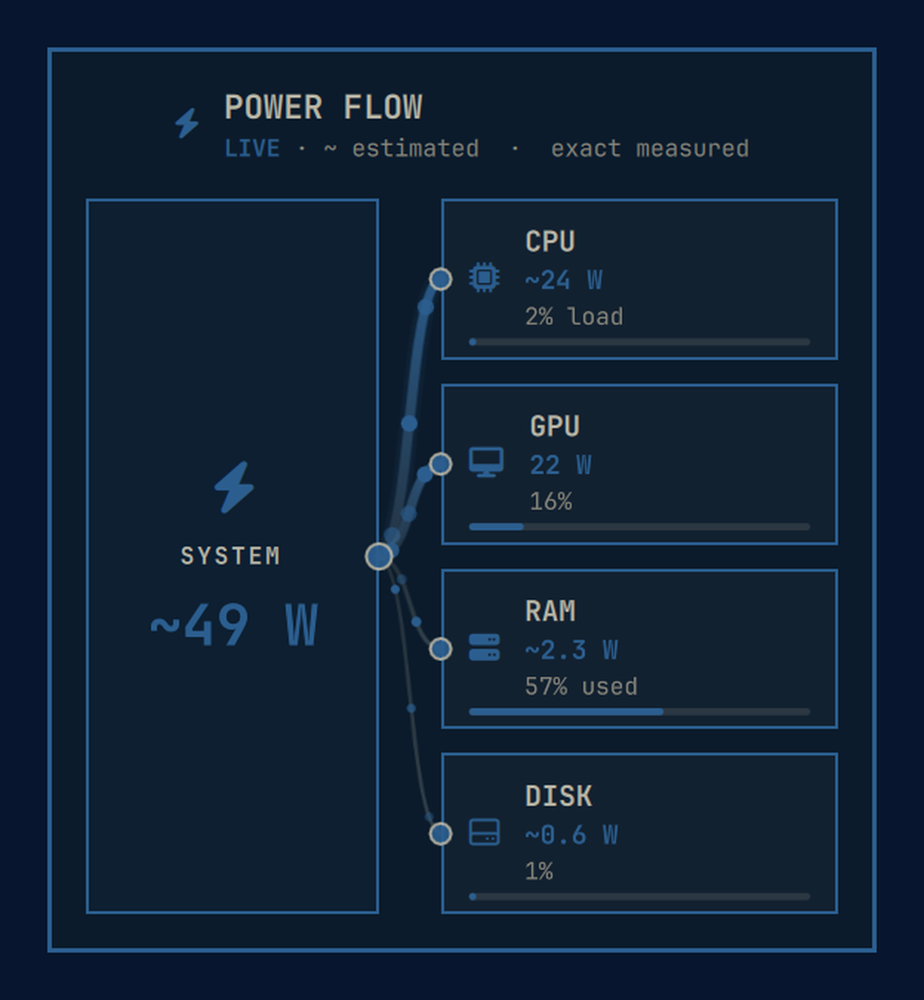

# Omarchy Power Flow

Omarchy Power Flow is an Omarchy shell plugin that turns live component power
readings into an animated power-flow panel. A source node feeds CPU, GPU, RAM,
and disk nodes through Bezier cords; faster flow represents a larger power
draw.

The plugin adds a compact bolt icon to the right side of the Omarchy bar. Activate it to open a bar-anchored power-flow dashboard; dismiss it with Escape, an outside click, or the same bar location. Directional energy packets move from the source toward each component, while stroke width, brightness, and packet energy make relative consumption visible at a glance.



## Requirements

- **Omarchy with the current Quickshell shell** — the only runtime platform
  dependency.
- **Linux hardware telemetry** — support is auto-detected for each component.
- **Bundled collector** — the Go collector ships as prebuilt static amd64/arm64
  binaries in `bin/`; no Go, Python, or other language runtime has to be
  installed to run the plugin.
- **`nvidia-smi` (optional)** — used only to read NVIDIA GPU power when no DRM
  power rail is available; it is not needed on AMD, Intel, or other systems.
- **Unprivileged by design** — installation, removal, and normal operation all
  run as your user. CPU package energy counters are often privileged on Linux,
  so the plugin uses a clearly marked load/frequency estimate instead of
  requesting additional access.

When CPU or RAM watt counters are not readable, the plugin uses clearly marked
estimates together with exact load and usage percentages.

The optional Super-key menu helpers use the system `python3` to validate JSONC.
That is the only Python use, it is confined to the menu install/remove scripts,
and it is not needed at plugin runtime.

## Install

From the published repository:

```sh
omarchy plugin add https://github.com/bjornramberg/omarchy-power-flow.git --enable
```

The repository is named `omarchy-power-flow`; the permanent plugin ID is
`io.github.bjornramberg.omarchy-power-flow`. All other plugin, shell, and bar
commands in this README use that ID.

Then open or toggle the panel:

```sh
omarchy-shell shell summon io.github.bjornramberg.omarchy-power-flow '{}'
omarchy-shell shell toggle io.github.bjornramberg.omarchy-power-flow '{}'
```

Hide it again with:

```sh
omarchy-shell shell hide io.github.bjornramberg.omarchy-power-flow
```

A Hyprland binding can summon it directly:

```ini
bind = SUPER, P, exec, omarchy-shell shell toggle io.github.bjornramberg.omarchy-power-flow '{}'
```

### Upgrading from UTH Power

Installations created under the old `uth.power` identity need a one-time
migration. From an up-to-date checkout of this repository, run:

```sh
./scripts/migrate-from-uth-power.sh
```

The script moves `~/.config/omarchy/plugins/uth.power` to
`~/.config/omarchy/plugins/io.github.bjornramberg.omarchy-power-flow`, updates
the plugin id in `~/.config/omarchy/shell.json`, and migrates the legacy
`uth-power` menu row to `omarchy-power-flow`. It backs up the files it rewrites,
requests a plugin rescan and menu refresh, stays entirely within your user
account, and is safe to rerun. It refuses to replace an existing new plugin
directory unless that directory's manifest declares the new ID.

If the installed plugin checkout still contains the old release, update it
before migrating so the moved directory already carries the new identity.

### Super-key menu entry

Omarchy plugin installation does not copy menu extensions automatically. Add
the optional Omarchy Power Flow row to the Super-key menu with the idempotent
helper:

```sh
./scripts/install-menu-entry.sh
```

The helper updates only `~/.config/omarchy/extensions/omarchy-menu.jsonc`,
backs up the existing file, migrates an older `uth-power` row in place, and
refreshes the menu. The mergeable source fragment is in
`extensions/omarchy-menu.jsonc`. Undo it with
`./scripts/remove-menu-entry.sh` (see [Remove](#remove)).

## Remove

Remove the plugin from Omarchy by its permanent ID:

```sh
omarchy plugin remove io.github.bjornramberg.omarchy-power-flow
```

If you installed the optional Super-key menu row, remove that row from a
checkout of this repository:

```sh
./scripts/remove-menu-entry.sh
```

The helper removes only the plugin's `omarchy-power-flow` row (and any legacy
`uth-power` row), preserves unrelated rows and comments, backs up the target
file, validates the resulting JSONC, and refreshes the menu. It is idempotent:
when the row is already absent it reports that and exits successfully, without
creating a backup or touching the file. It only writes
`~/.config/omarchy/extensions/omarchy-menu.jsonc`. The row's `when` guard
already hides it once the plugin is uninstalled, so the menu cleanup can run
before or after `omarchy plugin remove`.

## Local development

Validate the plugin before installing it:

```sh
omarchy plugin validate .
```

For a local checkout, place the repository at the plugin ID path and rescan the
shell:

```sh
git clone <url> ~/.config/omarchy/plugins/io.github.bjornramberg.omarchy-power-flow
omarchy-shell shell rescanPlugins
omarchy plugin enable io.github.bjornramberg.omarchy-power-flow --section right
```

The bolt icon is placed in the bar's right section. Reposition it with, for
example:

```sh
omarchy bar move io.github.bjornramberg.omarchy-power-flow --section right --after omarchy.power
```

If the plugin was previously enabled only through the `plugins[]` list, run
`omarchy plugin disable io.github.bjornramberg.omarchy-power-flow` before
enabling it as a bar widget.

Saving a file below
`~/.config/omarchy/plugins/io.github.bjornramberg.omarchy-power-flow/` reloads
the plugin.
The currently open panel closes during reload and must be summoned again.

## Build

The repository ships static Go binaries for amd64 and arm64 Linux.
`bin/omarchy-power-flow` is a small architecture-aware launcher used by the QML
panel.

```sh
./scripts/build-binaries.sh
./scripts/verify-binaries.sh
sha256sum -c SHA256SUMS
```

`verify-binaries.sh` rebuilds both architectures with the pinned Go toolchain
and compares them byte-for-byte with the tracked binaries.

Run the backend checks with:

```sh
cd backend
gofmt -l .
go test ./...
go vet ./...
```

## Architecture

```text
manifest.json              Omarchy bar-widget plugin manifest
qml/PowerFlow.qml          Bar icon, lifecycle, process bridge, anchored popup
qml/PowerFlowWidget.qml    Dashboard, source hub, consumer tiles, cord layer
qml/AnimatedCord.qml       Continuous watt-share gradient and energy packets
backend/                   Go sensor collector and tests
bin/                       Static amd64/arm64 collector binaries and launcher
extensions/                Optional Super-key menu row
scripts/                   Build, verification, menu helpers, and migration
SHA256SUMS                 Published hashes for bundled collector binaries
SECURITY.md                Security model, build provenance, and reporting
TODO.md                    Optional one-time calibration plan
```

The Go collector emits one compact JSON object per line on standard output.
The QML side parses complete lines and ignores malformed or partial output.
Logs are kept on standard error so they never corrupt the data stream.

## Sensor behavior

| Component | Primary source | Fallback |
| --- | --- | --- |
| CPU | Linux powercap energy zones | A marked estimate from measured CPU load, CPU class, and frequency ratio |
| GPU | DRM hwmon power/energy sensors | `nvidia-smi` for NVIDIA; omitted if no rail is readable |
| RAM | Powercap `dram` energy zones | A marked estimate from installed capacity, memory pressure, and CPU activity |
| Disk | `/proc/diskstats` busy time | A marked estimate from real block-device I/O activity; partitions and virtual devices are excluded |

Measured values always win over estimates. Estimated values are prefixed with
`~` and carry source/uncertainty metadata; utilization-only values are shown
as load/usage without claiming watts.

The source total is the sum of the visible component readings and is therefore
`~`-marked whenever any estimate contributes. It is not a whole-system
wall-plug measurement and does not include unmeasured components.

CPU package energy counters are commonly restricted to root on current Linux
kernels. The plugin itself needs no elevated privileges, so the CPU fallback is
a load/frequency model rather than a hardware measurement.

### Process insights

Hovering a component exposes the most useful process-level signal Linux can
provide without privileges:

- **CPU:** the leading process by machine CPU share, with both percentage of
  the machine and percentage of one CPU core.
- **RAM:** the process with the largest resident set (RSS).

These are activity indicators, not power attribution. Linux does not expose
per-process DRAM or GPU watts, and process I/O permissions are incomplete, so
the plugin intentionally does not make disk/GPU process-power claims.

The collector performs one bounded `/proc/<pid>/stat` scan per second. It
measures about 5 ms per scan on a roughly 460-process host. Disable it with:

```sh
omarchy-power-flow --processes off
```

### Reliability and diagnostics

The collector and panel fail independently and visibly:

- Backend panics are recovered, reported with a bounded stderr diagnostic, and
  exit with code 70; stdout is never allowed to contain partial JSON.
- The panel validates schema-v2 samples before replacing good telemetry.
- Missing, crashing, or unresponsive collectors use bounded exponential
  backoff, a four-second data watchdog, and a user-visible retry/error state.
- The last good reading remains visible and is marked stale rather than being
  silently replaced with zeros.

Useful checks:

```sh
omarchy plugin validate ~/.config/omarchy/plugins/io.github.bjornramberg.omarchy-power-flow
~/.config/omarchy/plugins/io.github.bjornramberg.omarchy-power-flow/bin/omarchy-power-flow --once
journalctl --user -t omarchy-shell -f
```

Collector exit codes are `0` for clean shutdown, `1` for output failure, `2`
for invalid arguments, and `70` for an internal panic.

### Optional calibration

A future optional calibration workflow may capture machine-specific CPU power
coefficients in a separate, explicitly authorized step while the application
itself continues to run unprivileged. The design constraints are tracked in
`TODO.md`; no calibration or privilege escalation is performed automatically.

## JSON contract

Each stdout line has this shape:

```json
{
  "schema_version": 2,
  "source": {
    "name": "AC",
    "total_draw_w": 153.89,
    "battery_percentage": 87,
    "total_draw_kind": "mixed",
    "power_mode": "ac",
    "battery_status": "charging"
  },
  "components": [
    {
      "id": "cpu",
      "label": "CPU",
      "draw_w": 27.0,
      "max_w": 142.0,
      "activity_percent": 8,
      "draw_kind": "modeled",
      "draw_source": "model:cpu-load/1",
      "utilization_percent": 8,
      "uncertainty_percent": 35,
      "model": {
        "id": "cpu-load/1",
        "assumptions": {}
      },
      "top_process": {
        "pid": 1234,
        "name": "firefox",
        "metric": "cpu",
        "value": 6.25,
        "unit": "percent_of_machine",
        "core_percent": 100.0,
        "window_ms": 1000,
        "scope": "visible_processes",
        "source": "proc:stat",
        "ok": true
      }
    },
    {
      "id": "gpu",
      "label": "GPU",
      "draw_w": 124.0,
      "max_w": 135.0,
      "activity_percent": 92,
      "draw_kind": "measured",
      "draw_source": "hwmon:amdgpu"
    }
  ]
}
```

`battery_percentage` is `-1` when no system battery level is available.
`power_mode` explicitly reports `ac`, `battery`, or `unknown`, and the UI
chooses the plug, battery, or generic power glyph from that state. Stable
component IDs are `cpu`, `gpu`, `ram`, and `disk`. `draw_kind` distinguishes
hardware measurements from estimates and utilization-only values; modeled
components also include uncertainty and model provenance. `top_process` is
optional activity metadata and never represents watts.

## License

Omarchy Power Flow is released under the [MIT License](LICENSE).

Copyright (c) 2026 Björn Ramberg.
